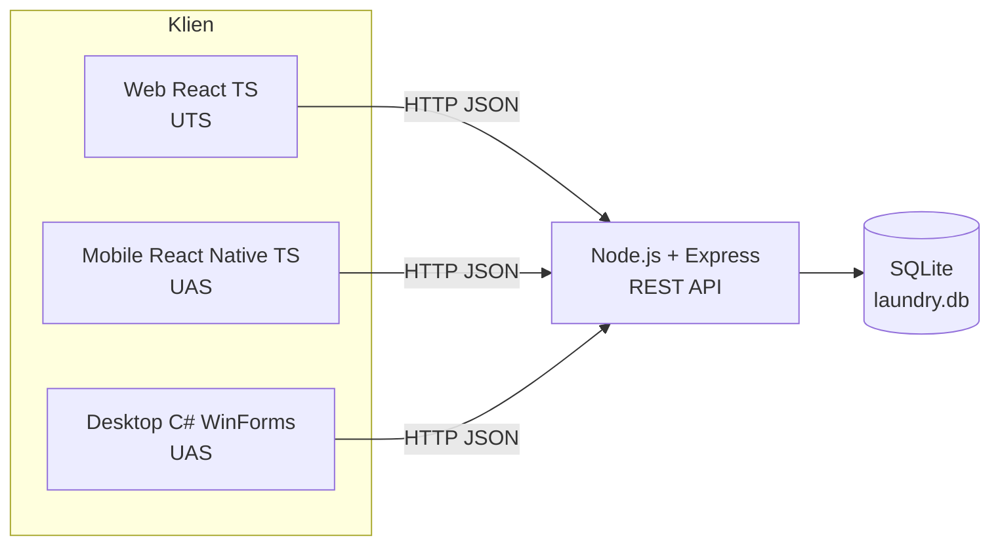
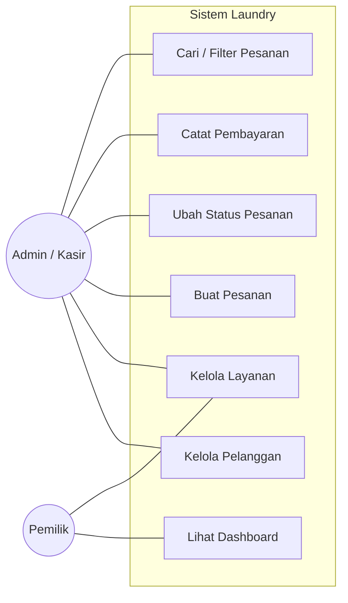
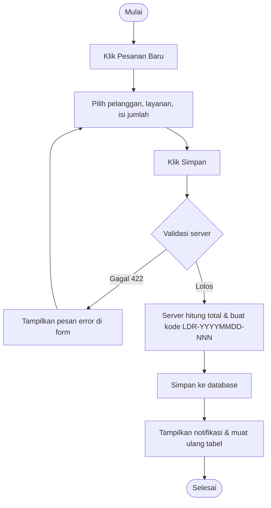
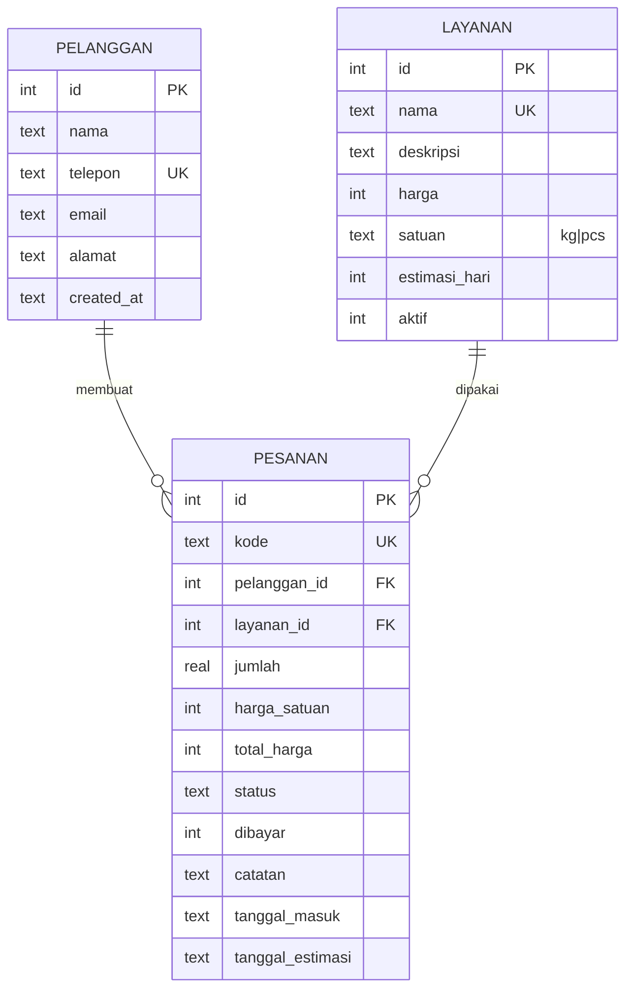
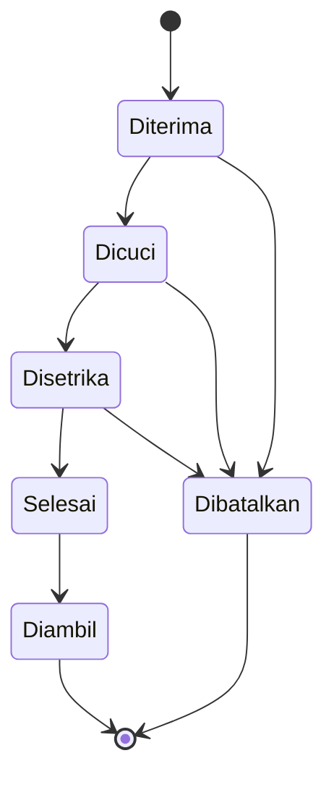

# Dokumentasi Proyek — Sistem Laundry (Rinso Laundry)

Mata kuliah **Pengembangan Aplikasi berbasis Platform (PBAD) 2026/2027** · Tahap **UTS**: Web Client ⇄ REST API (komunikasi dua arah).

> Isi nama kelompok, anggota, dan peran pada bagian 1 sebelum dikumpulkan.

## 1. Identitas Kelompok

| Nama | NIM | Peran |
|------|-----|-------|
| (isi) | (isi) | API Server & Web |
| (isi) | (isi) | API Server & Mobile |
| (isi) | (isi) | API Server & Desktop |

Aturan Git: setiap anggota melakukan commit dengan akun GitHub masing-masing; dosen memeriksa riwayat commit.

## 2. Latar Belakang

Usaha laundry skala kecil dan menengah umumnya mencatat pesanan secara manual pada buku nota. Cara ini menimbulkan masalah: nota hilang, status cucian tidak dapat dilacak pelanggan, perhitungan harga salah, dan pemilik sulit melihat pendapatan harian. Sistem ini mendigitalkan proses tersebut: pelanggan, layanan, dan pesanan tercatat terpusat pada **satu API server dan satu database**, lalu diakses oleh tiga klien (Web, Mobile, Desktop). Pada UTS, klien yang diselesaikan adalah **Web (React TypeScript)**.

## 3. Requirement & Permasalahan

**Permasalahan**

1. Pencatatan manual rawan salah dan sulit dicari.
2. Status cucian tidak transparan.
3. Rekap pendapatan dan pesanan belum dibayar tidak tersedia secara cepat.
4. Data tersebar jika setiap platform memiliki penyimpanan sendiri.

**Kebutuhan fungsional**

| Kode | Kebutuhan |
|------|-----------|
| F-01 | Mengelola (CRUD) data pelanggan, termasuk pencarian dan pagination |
| F-02 | Mengelola (CRUD) layanan beserta tarif, satuan (kg/pcs), estimasi hari, dan status aktif |
| F-03 | Membuat pesanan; total harga dihitung otomatis dari tarif layanan |
| F-04 | Memperbarui status pesanan mengikuti alur: Diterima → Dicuci → Disetrika → Selesai → Diambil (atau Dibatalkan) |
| F-05 | Menandai pembayaran lunas / belum bayar |
| F-06 | Mencari dan memfilter pesanan berdasarkan kata kunci, status, dan pembayaran |
| F-07 | Dashboard statistik: total pesanan, dalam proses, siap diambil, pendapatan, grafik 7 hari, layanan terlaris |

**Kebutuhan non-fungsional:** satu database terpusat untuk semua klien; respons JSON konsisten; validasi di sisi server; integritas relasi (pelanggan/layanan yang dipakai pesanan tidak dapat dihapus); antarmuka responsif dengan tema terang/gelap otomatis.

**Aturan bisnis**

- Harga satuan dikunci saat pesanan dibuat, sehingga perubahan tarif tidak mengubah pesanan lama.
- Status hanya boleh maju satu tahap; pembatalan hanya sebelum status *Selesai*.
- Pesanan berstatus *Diambil* atau *Dibatalkan* tidak dapat diubah; hanya *Diterima* dan *Dibatalkan* yang dapat dihapus.
- Nomor telepon pelanggan dan nama layanan harus unik.

## 4. Arsitektur



Teknologi: Node.js, Express, SQLite (`node:sqlite`), React 18, TypeScript, Vite, React Router. Monorepo npm workspaces: `server/` (API) dan `web/` (klien).

## 5. Use Case Diagram



| Use case | Aktor | Skenario utama |
|----------|-------|----------------|
| Buat Pesanan | Admin | Pilih pelanggan → pilih layanan → isi jumlah → sistem menghitung total → simpan (POST `/api/pesanan`) |
| Ubah Status | Admin | Buka detail pesanan → klik tombol tahap berikutnya (PATCH `/api/pesanan/:id/status`) |
| Catat Pembayaran | Admin | Buka detail → “Tandai lunas” (PATCH `/api/pesanan/:id/bayar`) |
| Lihat Dashboard | Pemilik | Membuka halaman utama → web memuat GET `/api/stats` |

## 6. Flowchart Pembuatan Pesanan



## 7. Data Model



Diagram status pesanan:



## 8. Dokumentasi REST API

Base URL: `http://localhost:3001/api` · Format: JSON · Tanpa autentikasi (tahap UTS).

**Format respons**

```json
{ "success": true, "data": { }, "meta": { "page": 1, "limit": 10, "total": 25, "totalPages": 3 } }
{ "success": false, "error": { "message": "Validasi gagal", "details": { "nama": "Nama wajib diisi" } } }
```

Kode status: `200` OK · `201` dibuat · `400` permintaan/ID tidak valid · `404` tidak ditemukan · `409` konflik (duplikat / aturan bisnis) · `422` validasi gagal · `500` kesalahan server.

### 8.1 Umum

| Method | Endpoint | Request | Response |
|--------|----------|---------|----------|
| GET | `/health` | — | `200` `{ status: "ok", waktu }` |
| GET | `/stats` | — | `200` `{ pelanggan, layanan_aktif, pesanan, dalam_proses, siap_diambil, pendapatan, belum_dibayar, per_status, layanan_teratas[], harian[] }` |

### 8.2 Pelanggan

| Method | Endpoint | Request | Response |
|--------|----------|---------|----------|
| GET | `/pelanggan` | Query: `search`, `page`, `limit` | `200` array pelanggan + `meta` |
| GET | `/pelanggan/:id` | — | `200` objek pelanggan · `404` |
| POST | `/pelanggan` | Body: `{ nama*, telepon*, email, alamat }` | `201` pelanggan baru · `422` validasi · `409` telepon sudah ada |
| PUT | `/pelanggan/:id` | Body sama dengan POST | `200` pelanggan terbarui · `404` · `422` · `409` |
| DELETE | `/pelanggan/:id` | — | `200` `{ id }` · `409` jika masih punya pesanan · `404` |

### 8.3 Layanan

| Method | Endpoint | Request | Response |
|--------|----------|---------|----------|
| GET | `/layanan` | Query: `search`, `aktif=1`, `page`, `limit` | `200` array layanan + `meta` |
| GET | `/layanan/:id` | — | `200` objek layanan · `404` |
| POST | `/layanan` | Body: `{ nama*, deskripsi, harga*, satuan* (kg/pcs), estimasi_hari*, aktif }` | `201` layanan baru · `422` · `409` nama sudah ada |
| PUT | `/layanan/:id` | Body sama dengan POST | `200` layanan terbarui · `404` · `422` · `409` |
| DELETE | `/layanan/:id` | — | `200` `{ id }` · `409` jika dipakai pesanan · `404` |

### 8.4 Pesanan

| Method | Endpoint | Request | Response |
|--------|----------|---------|----------|
| GET | `/pesanan` | Query: `search`, `status`, `dibayar` (0/1), `pelanggan_id`, `page`, `limit` | `200` array pesanan (dengan `pelanggan_nama`, `layanan_nama`) + `meta` |
| GET | `/pesanan/:id` | — | `200` pesanan + `status_berikutnya[]` · `404` |
| POST | `/pesanan` | Body: `{ pelanggan_id*, layanan_id*, jumlah*, catatan, dibayar }` | `201` pesanan baru (kode & total dihitung server) · `422` |
| PUT | `/pesanan/:id` | Body sama dengan POST | `200` pesanan terbarui · `409` jika sudah Diambil/Dibatalkan |
| PATCH | `/pesanan/:id/status` | Body: `{ status* }` | `200` pesanan · `409` transisi tidak valid |
| PATCH | `/pesanan/:id/bayar` | Body: `{ dibayar }` | `200` pesanan |
| DELETE | `/pesanan/:id` | — | `200` `{ id }` · `409` jika status bukan Diterima/Dibatalkan |

Contoh `POST /api/pesanan`:

```json
// Request
{ "pelanggan_id": 1, "layanan_id": 2, "jumlah": 3, "catatan": "Pisahkan baju putih" }
// Response 201
{ "success": true, "data": { "id": 10, "kode": "LDR-20261109-003", "pelanggan_nama": "Budi Santoso",
  "layanan_nama": "Cuci Kilat", "jumlah": 3, "harga_satuan": 10000, "total_harga": 30000,
  "status": "Diterima", "dibayar": 0, "tanggal_masuk": "2026-11-09", "tanggal_estimasi": "2026-11-10" } }
```

## 9. Desain UI (Web)

| Halaman | Rute | Isi |
|---------|------|-----|
| Dashboard | `/` | 4 kartu statistik, grafik batang pesanan 7 hari, distribusi status, pesanan terbaru, layanan terlaris |
| Pesanan | `/pesanan` | Tabel dengan pencarian + filter status/pembayaran, pagination, modal form pesanan (total dihitung langsung), modal detail dengan stepper status & aksi |
| Pelanggan | `/pelanggan` | Tabel + pencarian + pagination, modal tambah/ubah, dialog konfirmasi hapus |
| Layanan | `/layanan` | Kartu layanan (tarif, estimasi, jumlah pesanan), tambah/ubah, aktif/nonaktif, hapus |

Prinsip UI: tema terang/gelap otomatis (`prefers-color-scheme`), indikator koneksi API di header, status *loading / error / kosong* di setiap daftar, notifikasi toast, validasi form dari server ditampilkan per kolom.

```
┌──────────────────────────────────────────────────────────────┐
│ ◎ Rinso Laundry  [Dashboard][Pesanan][Pelanggan][Layanan] ● API │
├──────────────────────────────────────────────────────────────┤
│ Dashboard                                  [Lihat semua pesanan]│
│ ┌────────┐ ┌────────┐ ┌────────┐ ┌────────┐                    │
│ │ Total  │ │Diproses│ │ Siap   │ │Pendapat│                    │
│ └────────┘ └────────┘ └────────┘ └────────┘                    │
│ ┌─ Pesanan 7 hari ──────┐ ┌─ Pesanan per status ─┐             │
│ │  ▇ ▅ ▇ ▃ ▆ ▂ ▅       │ │ ● Diterima  ▬▬  2    │             │
│ └───────────────────────┘ └──────────────────────┘             │
└──────────────────────────────────────────────────────────────┘
```

## 10. Integrasi Web ⇄ API

- Seluruh akses data melalui modul `web/src/lib/api.ts` (fetch bertipe TypeScript). Saat pengembangan, Vite mem-*proxy* `/api` ke `http://127.0.0.1:3001`.
- **GET**: daftar & detail dimuat lewat hook `useAsync` (state `loading`, `error`, `data`) dan dimuat ulang saat filter/halaman berubah.
- **POST/PUT/PATCH/DELETE**: dikirim dari form React (controlled components); error validasi `422` dipetakan ke kolom form, lalu data dimuat ulang.
- Komunikasi dua arah terbukti: data yang dibuat di web tersimpan di SQLite dan langsung muncul kembali pada daftar & dashboard.

## 11. Pengujian

`npm test` menjalankan 7 tes integrasi API (CRUD, validasi, aturan bisnis, alur status, statistik, penanganan error). Pengujian manual UI: tambah pelanggan, buat pesanan, ubah status sampai Diambil, tandai lunas, cari/filter, hapus.

## 12. Rencana UAS

- Klien Mobile (React Native TS) dan Desktop (C# WinForms) memakai **API & database yang sama** (tidak boleh ada database terpisah).
- Pengembangan lanjutan: autentikasi (JWT), laporan periode, notifikasi pesanan selesai.

## 13. Daftar Periksa Pengumpulan

- [ ] Master Document (PDF) — dapat dibuat dari berkas ini
- [ ] Repositori GitHub + undang dosen; tiap anggota punya commit dari akunnya sendiri
- [ ] Video demo maksimal 5 menit (GET & POST dari web ke API)
